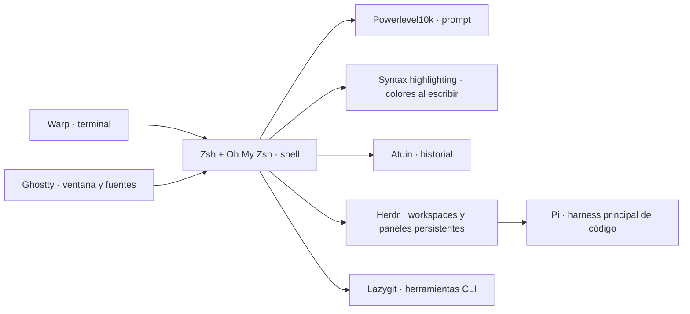

# Dotfiles · Ricardo Tovar

Mi flujo principal de código: **Herdr + Pi**, sobre **Zsh + Oh My Zsh + Powerlevel10k**.
**Warp y Ghostty** son las terminales; **Atuin** gestiona el historial y **Lazygit**
es una herramienta auxiliar. Un repositorio para los ajustes; cada herramienta
conserva sus propios datos, paquetes y sesiones.

Probado en **macOS con Apple Silicon**. El instalador reconoce las rutas XDG de
Linux, pero ese entorno todavía no está verificado.

## El stack



| Componente | Configuración | Qué aporta |
|---|---|---|
| Warp | Ajustes en la aplicación | Terminal; comparte los dotfiles de Zsh |
| Herdr | [herdr/config.toml](herdr/config.toml) | Workspaces, paneles y sesiones de código persistentes |
| Pi | Instalación y datos externos al repo | Harness principal de código dentro de Herdr |
| Zsh / Oh My Zsh | [zsh/](zsh/) | Entorno, completions, plugin `git` y atajos |
| Powerlevel10k | [zsh/.p10k.zsh](zsh/.p10k.zsh) | Prompt personal e inicio rápido |
| Ghostty | [ghostty/config](ghostty/config) | Catppuccin Mocha, Meslo Nerd Font y teclado |
| Atuin | [atuin/config.toml](atuin/config.toml) | Búsqueda del historial de comandos |
| Lazygit | [lazygit/config.yml](lazygit/config.yml) | Interfaz Git con tema Catppuccin |

Las preferencias de Warp se administran en la aplicación; este repo no versiona
configuración específica de Warp. Herdr usa la configuración mínima vigente,
no el antiguo perfil de `herdr-config`.

## Herdr y plugins actuales

Inventario comprobado el **2026-10-13**: **Herdr 0.9.3** y **Pi 1.2.0**.
El servidor está activo, su API detecta `pi` en el panel y la integración Pi de
Herdr está instalada y vigente (`v9`). Pi es el harness principal elegido;
los aliases de otros agentes se conservan como alternativas.

| Plugin habilitado | Versión | Estado observado |
|---|---|---|
| `heeler` | 0.5.0 | Arranque y hooks de actividad/notificaciones exitosos; emparejamiento móvil no comprobado |

**Heeler es el único plugin instalado y habilitado**. Se retiraron los plugins
`herdr-tsk`, `ttt.editor`, `rcosteira.account-switch` y `herdr-agent-usage`, junto
con sus configuraciones locales; el watcher de Agent Usage también se detuvo.
Las CLI independientes `ttt` y `tsk` se conservan, al igual que las cuentas y
credenciales. Las carpetas residuales de otros plugins no equivalen a plugins
instalados. Consulta [Herdr, Pi y plugins](docs/herdr.md) para comprobar el estado
y la fuente de instalación.

Para trabajar, ejecuta `herdr` en tu terminal y después `pi` dentro del panel
del proyecto. El instalador no abre agentes, instala plugins ni cambia cuentas.

## Empezar

Necesitas **Git, Zsh y Python 3.11+**. Instala Oh My Zsh, Powerlevel10k y el
resaltado siguiendo la [guía de instalación](docs/setup.md).

```sh
git clone https://github.com/rtovardev/dotfiles.git ~/workspace/developer/personal/dotfiles
cd ~/workspace/developer/personal/dotfiles

# Revisar qué archivos se enlazarán.
python3 scripts/install.py

# Crear respaldos y aplicar los enlaces.
python3 scripts/install.py --apply

# Comprobar sintaxis y enlaces.
python3 scripts/check.py --installed
```

Puedes clonar en otra carpeta: el instalador resuelve las rutas desde el propio
repo. Mantén esa carpeta disponible mientras sus archivos estén enlazados.

Después, abre una nueva shell con `exec zsh`. En Ghostty, recarga la configuración
con **Cmd + Shift + ,**.

## Cómo funciona

- El instalador muestra un plan antes de aplicar. Repetir una instalación correcta
  no modifica los enlaces ni genera otro respaldo.
- Los archivos anteriores se guardan en `~/.local/state/dotfiles/backups/`.
- Oh My Zsh gestiona las completions. Atuin y WTP se inicializan antes de cargar
  el resaltado una sola vez al final.
- El entorno conserva las toolchains instaladas y elimina duplicados de `PATH`.
  El editor usa Vim por SSH y, localmente, Neovim, Helix o Vim según disponibilidad.
- `SSH_AUTH_SOCK` se hereda del entorno, respetando el agente SSH del sistema.

Los paquetes del [Brewfile](Brewfile) se instalan **por separado**:

```sh
brew bundle --file=Brewfile
```

Ese comando puede instalar o actualizar herramientas. El instalador de enlaces
no ejecuta Homebrew ni instala frameworks o plugins.

## Personalizar

Edita los archivos del repo y revisa el diff antes de guardar los cambios. Para
configurar el prompt, usa `p10k configure`; la guía explica cómo conservar el
enlace si el asistente reemplaza `~/.p10k.zsh`.

Los ajustes de una sola máquina pueden vivir fuera de Git:

| Archivo local | Se carga en |
|---|---|
| `~/.config/zsh/env.local.zsh` | Todas las shells Zsh |
| `~/.config/zsh/local.zsh` | Shells interactivas, antes del resaltado |

Los [atajos de agentes](docs/shell.md#atajos-de-agentes) reflejan mis preferencias;
revísalos si vas a reutilizar esta configuración.

## Documentación

- [Instalación y dependencias](docs/setup.md)
- [Zsh, integraciones y atajos](docs/shell.md)
- [Herdr, Pi y plugins](docs/herdr.md)
- [Mantenimiento, comprobaciones y restauración](docs/maintenance.md)
- [Consolidación de los repos anteriores](docs/migration.md)

Las cuentas, credenciales, historiales, bases de datos, sesiones, cachés y backups
privados se conservan fuera de este repositorio. Los frameworks y plugins también
se instalan aparte.
